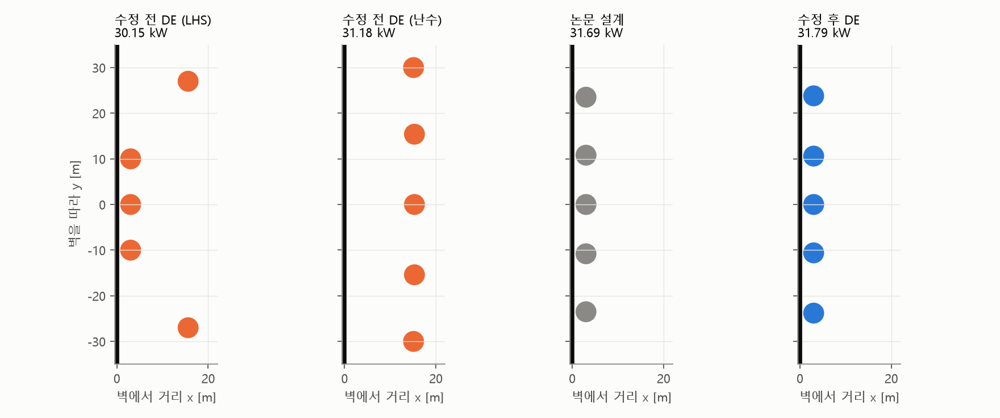
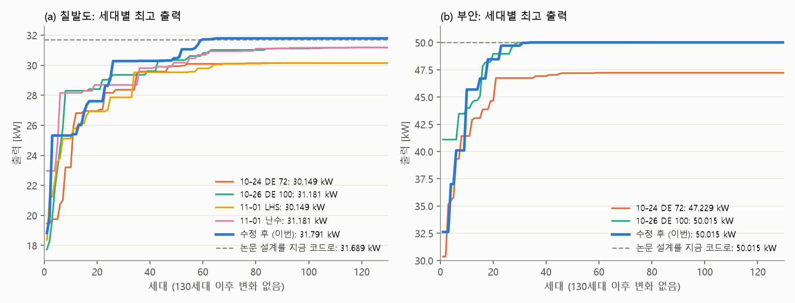
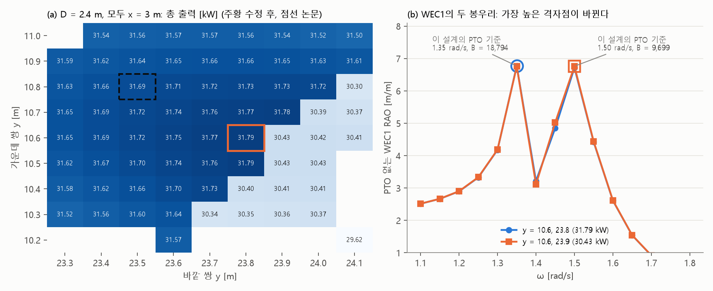

# 벽 옆 정답을 다시 찾았어요

## 무엇을 확인했나요?

얼마 전에 컴퓨터의 "좋은 설계 찾기"(DE) 방법을 고쳤습니다. 친구들의 **짝꿍 순서를 억지로 맞추지 않게** 한 것입니다. 고친 뒤에 정말 좋은 답을 찾는지 칠발도와 부안 바다에서 시험했습니다.

이번 글은 **답이 얼마나 좋은가**만 봅니다. 계산하는 동안 같은 컴퓨터에서 다른 일도 했기 때문에, 시간은 공정하게 비교할 수 없어서 뺐습니다.

## 결과는요?

**칠발도**: 부표 다섯 개를 모두 벽 옆에 두는 답을 찾았습니다. 논문의 답과 같은 자리입니다.

| 언제 | 찾은 답 | 발전량 |
| --- | --- | --- |
| 고치기 전 (4번 시도) | 벽에서 먼 부표가 있는 배치 | 30.15 ~ 31.18 kW |
| 논문의 답 (지금 프로그램으로 계산) | 다섯 개 모두 벽 옆 | 31.69 kW |
| **고친 뒤** | **다섯 개 모두 벽 옆** | **31.79 kW** |

왼쪽 검은 선이 벽이고, 동그라미가 부표입니다. 오른쪽 두 그림이 거의 똑같지요?

**부안**: 논문과 똑같은 설계를 찾았습니다(50.015 kW). 그런데 고치기 전에도 한 번 찾은 적이 있어서, 이것만으로는 고친 덕분이라고 말할 수 없습니다.

## 새로 알게 된 것: 계단

칠발도 답 바로 옆을 보니 이상한 곳이 있었습니다. 부표를 **10 cm만 옮겼는데 발전량이 4%나** 떨어졌습니다.

| 바깥 부표 위치 | 발전량 |
| --- | --- |
| 23.8 m | 31.79 kW |
| 23.9 m | 30.43 kW |

평평한 언덕을 걷다가 갑자기 계단을 만난 것과 같습니다.

**왜 그럴까요?** 부표마다 **브레이크**(PTO, 파도 힘을 전기로 바꾸는 장치)가 달려 있습니다. 프로그램은 부표가 가장 크게 흔들리는 파도를 찾아서, 거기에 맞춰 브레이크 세기를 정합니다.

그런데 가운데 부표는 크게 흔들리는 파도가 두 개 있고, 흔들리는 크기가 거의 같습니다. 달리기에서 1등과 2등이 거의 동시에 들어오는 것과 비슷합니다. 부표를 10 cm 옮기자 1등이 바뀌었고, 브레이크 세기가 **절반쯤으로** 바뀌었습니다. 그래서 발전량이 뚝 떨어진 것입니다.

정말 브레이크 때문인지 시험해 봤습니다. 두 설계의 브레이크만 서로 바꾸어 계산했더니 발전량도 함께 바뀌었습니다. 브레이크가 원인이 맞습니다.

이 규칙은 논문 때부터 있었습니다. 고장이 아니라 원래 계산 방식의 특징입니다. 그래도 이번 답은 "언덕 꼭대기"가 아니라 "계단 바로 앞"에 있다는 뜻입니다.

## 조심해서 읽어야 할 것

- **"논문보다 좋아졌다"고 보면 안 됩니다.** 0.32% 차이는 계단(4%)보다 훨씬 작습니다. "같은 자리를 찾았다"가 맞는 말입니다.
- **고친 뒤 칠발도 시험은 한 번뿐입니다.** 운이 좋았을 수도 있습니다.
- **가장 좋은 답이라는 보장은 없습니다.** 칠발도는 74번째, 부안은 47번째 세대부터 모두 같은 답으로 모여서, 그 뒤로는 새로운 곳을 찾지 않았습니다.

## 아직 안 풀린 문제

- 칠발도를 여러 번 더 돌려서 또 찾는지 봐야 합니다.
- 영일만항은 고친 뒤에 아직 돌리지 않았습니다.
- 브레이크 고르는 규칙을 그대로 둘지 정해야 합니다. 바꾸면 계단은 없어질 수 있지만 논문과 숫자를 바로 비교하기 어려워집니다.
