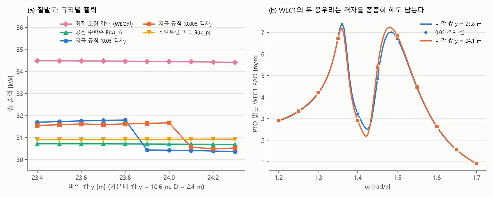

# 브레이크 세기를 정하는 규칙

## 왜 살펴봤나요?

지난 글에서 부표를 10 cm 옮겼더니 발전량이 4%나 떨어지는 "계단"을 찾았습니다. 부표의 **브레이크**(PTO, 파도 힘을 전기로 바꾸는 장치) 세기를 정하는 규칙 때문이었지요. 그래서 이 규칙이 괜찮은지 자세히 살펴봤습니다.

프로그램은 아직 고치지 않았습니다. 이번에는 살펴보기만 했습니다.

## 지금 규칙은요?

1. 브레이크 없이 부표가 파도마다 얼마나 흔들리는지 잽니다.
2. **가장 크게 흔들리는 파도** 하나를 고릅니다.
3. 그 파도에 맞춰 브레이크 세기를 정합니다.

## 알게 된 것 세 가지

**1. 눈금을 촘촘하게 해도 계단은 남아요.**

처음에는 파도를 재는 눈금이 성겨서 그런 줄 알았습니다. 그런데 눈금을 10배 촘촘하게 해도 계단은 사라지지 않고 조금 옆으로 옮겨 갔습니다.

| 눈금 | 계단이 나타나는 곳 |
| --- | --- |
| 0.05 간격 | 23.8 m와 23.9 m 사이 |
| 0.005 간격 | 24.0 m와 24.1 m 사이 |

키 재기에서 1등을 하나만 뽑으면, 두 친구 키가 비슷할 때 1등이 갑자기 바뀌는 것과 같습니다. 자를 정밀하게 바꿔도 1등이 바뀌는 순간은 여전히 있습니다.

**2. 고른 파도가 진짜 "딱 맞는 파도"가 아니었어요.**

그네에는 가장 잘 흔들리는 박자가 있습니다. 이것을 **공진**이라고 합니다. 설명서에는 공진에 맞춰 브레이크를 정한다고 적혀 있었습니다.

그런데 가운데 부표는 공진 박자(1.44)에서 오히려 덜 흔들리고, 그 양옆(1.36과 1.48)에서 더 크게 흔들렸습니다. 옆 부표와 벽이 함께 영향을 주는 것으로 보이는데, 정확한 이유는 아직 모릅니다. 규칙은 이 양옆 중 하나를 고르고 있었습니다.

**3. 브레이크를 더 세게 하면 전기가 더 많이 나와요.**

브레이크가 너무 약해도, 너무 세도 전기가 적게 나옵니다. 지금 브레이크는 가장 좋은 세기의 절반쯤이었습니다.

| 바다 | 지금 규칙 | 가장 좋은 세기 | 차이 |
| --- | --- | --- | --- |
| 칠발도 | 31.79 kW | 34.46 kW | +8.4% |
| 부안 | 50.02 kW | 62.41 kW | +24.8% |

왼쪽 그림에서 파란 선과 주황 선은 뚝 떨어지는 계단이 있지만, 다른 규칙들은 매끄럽습니다.

## 규칙을 바꾸면 끝일까요?

쉽지는 않습니다.

- **순위가 바뀝니다.** 규칙에 따라 "가장 좋은 배치"가 달라졌습니다. 가장 좋은 세기로 계산하면 벽에서 먼 배치가 벽 옆 배치보다 더 높게 나왔습니다. 다만 다섯 개 설계만 비교한 것이라, 정답은 다시 찾아봐야 합니다.
- **논문과 숫자를 바로 비교할 수 없습니다.** 논문은 지금 규칙으로 계산했기 때문입니다.
- **저금통 값을 다시 쓸 수 없습니다.** 저금통에는 발전량만 있어서, 규칙이 바뀌면 새로 계산해야 합니다.

## 잘못 알았던 것

- 계단이 눈금 때문일 수도 있다고 생각했는데, 규칙 때문이었습니다. 눈금은 계단 위치만 조금 옮깁니다.
- 설명서에 "공진에 맞춘다"고 적었지만, 실제로는 "가장 크게 흔들리는 곳에 맞춘다"였습니다. 이 설명은 고쳐야 합니다.

## 무엇을 고를까요?

| 방법 | 좋은 점 | 아쉬운 점 |
| --- | --- | --- |
| 그대로 두기 | 논문과 비교할 수 있음 | 계단이 남음 |
| 공진에 맞추기 | 설명서 뜻과 같고 계단이 없음 | 발전량은 늘지 않음 |
| 가장 좋은 세기 찾기 | 발전량이 가장 많고 계단이 없음 | 논문과 숫자가 많이 달라짐 |

저는 **평소에는 그대로 두고, "가장 좋은 세기"를 고를 수 있게 추가하는 것**을 권합니다. 논문과 비교할 때와 새 연구를 할 때 나누어 쓸 수 있기 때문입니다.

## 아직 모르는 것

- 부표 흔들림이 왜 두 봉우리로 갈라지는지
- 다른 규칙으로 찾으면 정답 배치가 어떻게 바뀌는지
- 실제 장치가 그만큼 센 브레이크를 견딜 수 있는지
