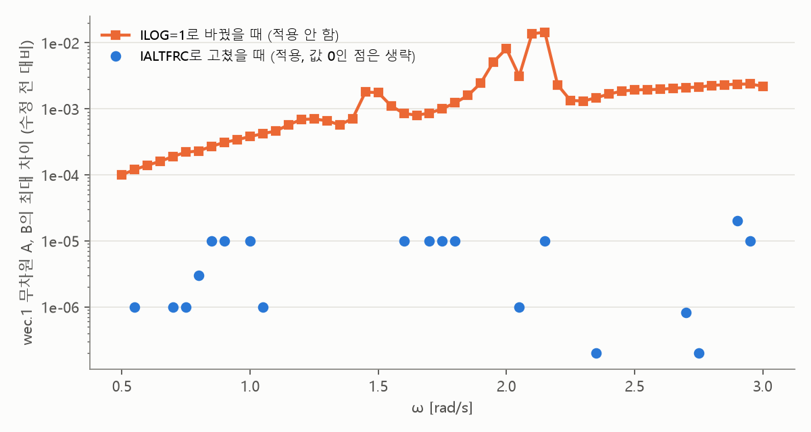

# 설정 파일의 오타

## 무슨 일이 있었나요?

WAMIT은 파도와 부표를 계산하는 프로그램입니다. 계산 전에 **설정 파일**을 읽습니다. 설정 파일은 "이렇게 계산해 줘" 하고 적어 주는 쪽지입니다.

동료에게 줄 샘플을 만들다가 이 쪽지에서 이상한 단어를 봤습니다. 설명서를 찾아보니 **오타가 두 개** 있었습니다.

| 쪽지에 적힌 말 | 설명서의 말 | 고쳤나요? |
| --- | --- | --- |
| `IALTERC` | `IALTFRC` | 고쳤어요 |
| `ILOC` | `ILOG`로 보여요 | 아직이요 |

## 오타가 있었는데 왜 계산이 됐나요?

WAMIT은 모르는 단어를 보면 화내지 않고 그냥 넘어갑니다. 그 대신 **기본값**(아무 말이 없을 때 쓰는 값)으로 계산합니다.

식당에서 "덜 맵게"를 알아볼 수 없게 적으면, 식당이 그 글자를 무시하고 보통 맛으로 주는 것과 같습니다.

## 첫 번째 오타: 고쳐도 답이 같아요

`IALTFRC`는 원래 기본값이 1입니다. 쪽지에 적으려던 값도 1이었습니다. 그래서 오타가 있어도 원하던 대로 계산되고 있었습니다.

고치기 전과 후를 계산해 보니 발전량이 똑같이 31.6894 kW였습니다.

## 두 번째 오타: 고치면 답이 조금 달라져요

`ILOG`는 기본값이 0인데, 쪽지에는 1을 적으려던 것으로 보입니다. 오타 때문에 그동안은 **0으로 계산되고 있었습니다.** 계산 기록에도 0이라고 찍혀 있었습니다.

| 설정 | 발전량 |
| --- | --- |
| 지금 (0으로 계산) | 31.6894 kW |
| 1로 바꾸면 | 31.6887 kW |

차이는 아주 작습니다. 1000 kW를 재다가 0.02 kW 다른 정도입니다. 그래도 값이 달라지면 논문과 그대로 비교하기 어렵고, 저금통에 모아 둔 계산 기록도 다시 쓸 수 없습니다. 그래서 **이것은 마음대로 고치지 않고 정해 달라고 물어보기로 했습니다.**

위쪽 주황색 네모가 `ILOG`를 1로 바꿨을 때입니다. 아래쪽 파란 점은 이번에 고친 오타입니다. 파란 점은 같은 계산을 다시 해도 생기는 작은 차이와 비슷합니다.

## 잘못 알았던 것

- 처음에는 오타가 하나인 줄 알았습니다. 설명서를 찾아보니 두 개였습니다.
- 고친 뒤 확인하는 중에 "달라진 것이 없다"는 결과가 나왔는데, 알고 보니 코드가 실제로 안 고쳐져 있었습니다. 다시 고치고 처음부터 확인했습니다.

## 아직 안 풀린 문제

- `ILOC` 줄을 어떻게 할지 정해야 합니다. 저는 지우는 것을 권합니다. 지워도 답이 같고, 헷갈리는 줄만 없어지기 때문입니다.
- 이번 비교는 설계 하나로만 했습니다.
